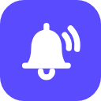
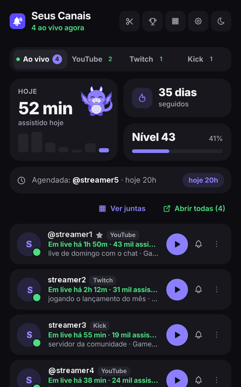
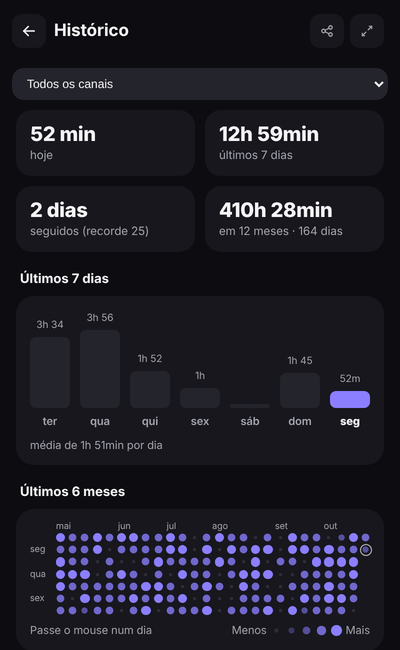
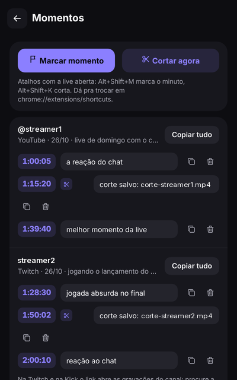
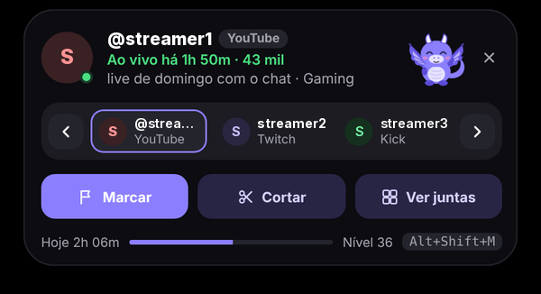

<h1 align="center">Seus Canais</h1>

Avisa quando seus canais do <b>YouTube</b>, da <b>Twitch</b> e da <b>Kick</b> entram ao vivo, guarda o seu histórico e tem conquistas, níveis e um dragãozinho pra quem acompanha lives todo dia.

<a href="#english">English version below</a>

  
  
  

Nos prints, os nomes dos canais foram alterados e as fotos removidas.

Tudo roda no seu navegador. Não tem cadastro, não tem servidor e nada do que você assiste é enviado pra lugar nenhum.

> **Versão 1.0.0, a primeira pública.** Pode ter bugs e coisas que ainda não funcionam direito. Achou algum problema? Use **Configurações → Sobre → Reportar problema**, abra uma [issue](../../issues) ou chame no X: [@lucaslourenzii](https://x.com/lucaslourenzii).

---

## Sumário

- [Como instalar](#como-instalar)
- [Como atualizar](#como-atualizar)
- [Primeiros passos](#primeiros-passos)
- [Avisos de live](#avisos-de-live)
- [Ilha nas páginas de live](#ilha-nas-páginas-de-live)
- [Momentos e cortes](#momentos-e-cortes)
- [Ver juntas](#ver-juntas)
- [Seu dia e lives agendadas](#seu-dia-e-lives-agendadas)
- [Histórico](#histórico)
- [Nível, conquistas e desafios](#nível-conquistas-e-desafios)
- [Mascote e personalização](#mascote-e-personalização)
- [Sincronizar entre computadores](#sincronizar-entre-computadores)
- [Configurações](#configurações)
- [Achou um problema?](#achou-um-problema)
- [Privacidade](#privacidade)
- [English](#english)
- [Licença](#licença)

---

## Como instalar

A extensão não está na loja do Chrome, então a instalação é manual. Leva uns dois minutos:

1. **Baixe a versão mais nova** em [Releases](../../releases/latest) (arquivo `.zip`).
2. **Extraia a pasta.** Clique com o botão direito no arquivo baixado e escolha **Extrair tudo...**.
3. **Abra as extensões do navegador.** No Chrome, Edge, Brave ou Opera, digite na barra de endereço: `chrome://extensions/`
4. **Ative o Modo do desenvolvedor**, na chave do canto superior direito.
5. Clique em **Carregar sem compactação** (*Load unpacked*) e escolha a pasta que você extraiu.

Pronto. Pra deixar sempre à mão, clique no ícone de quebra-cabeça na barra do navegador e no alfinete ao lado do Seus Canais.

## Como atualizar

Quando sair uma versão nova, aparece um aviso no topo do popup com o botão **Baixar**. Também dá pra conferir em **Configurações → Sobre → Procurar atualização**.

Pra atualizar: baixe o `.zip` novo, troque os arquivos da pasta antiga pelos novos e clique no botão de recarregar (↻) do Seus Canais em `chrome://extensions/`. Seus canais, histórico e conquistas continuam lá.

---

## Primeiros passos

Na primeira instalação abre uma tela de boas-vindas. Dá pra adicionar canais de vários jeitos:

- **Importar os canais que você já segue.** Abra as Inscrições do YouTube (`youtube.com/feed/channels`), os canais seguidos da Twitch ou a página Seguindo da Kick. Aparece um botão **Importar pro Seus Canais** no canto da tela: a extensão carrega a lista inteira, você marca quais quer e importa de uma vez.
- **Digitar no popup:** escolha a aba da plataforma e digite o @ do canal ou cole o link.
- **Botão direito** numa página de canal (ou num link de canal): **Adicionar este canal ao Seus Canais**.
- **Estando na página do canal:** abra o popup e aparece o botão **Adicionar**.

---

## Avisos de live

- **Notificação quando entra ao vivo**, com título, jogo e quantas pessoas estão assistindo.
- **Card na página:** se você estiver no YouTube, na Twitch ou na Kick, o aviso aparece na própria página, com o dragãozinho e o botão **Assistir**.
- **Abrir a live sozinho** (opcional, por canal): quando ela começa, ou assim que uma live for agendada (YouTube e Twitch), uma por canal de cada vez. Não abre de novo se já estiver aberta.
- **Vídeos novos no YouTube**, **mudança de título ou jogo** e **palavras-chave** no título (opcionais, por canal).
- **Longe do PC:** se o computador ficar parado ou bloqueado, os avisos esperam e chegam num resumo quando você volta.
- **Lives perdidas:** quando uma live de um favorito acaba e você não viu, chega um aviso que leva pra gravação.
- **Menções no chat:** coloque seu nick nas configurações e a extensão avisa quando te marcarem (com o chat aberto em alguma aba).
- **Não perturbe e horário de silêncio:** a extensão continua verificando e contando o histórico, só não avisa.

---

## Ilha nas páginas de live

Uma pílula no topo da página do YouTube, da Twitch e da Kick, inspirada na Dynamic Island. Mostra o dragãozinho, quantos canais estão ao vivo e a live que você está vendo.

Passando o mouse ela abre e dá pra:

- **Trocar de live** entre os seus canais ao vivo, com as setas ou clicando no canal
- **Marcar o momento** da live
- **Cortar** (veja abaixo)
- Abrir o **Ver juntas**

Ela também mostra "momento salvo" e "fulano entrou ao vivo", com a foto do canal. Segue a sua cor e o tema claro ou escuro, com o fundo levemente transparente. **Segure e arraste** pra levar ela pra onde quiser na tela. Em **tela cheia** ela continua aparecendo: surge quando você mexe o mouse e some sozinha depois de uns segundos. Dá pra desligar em **Configurações → Ilha nas páginas de live**, ou no × da própria ilha.

Ainda sem nenhum canal na lista? Abrindo a página de um canal, a ilha aparece com o botão **+ Adicionar à lista**.

**Modo foco**, pra quem assiste trabalhando, também fica na ilha aberta:

- **Menos internet:** coloca a live na menor qualidade (YouTube e Twitch). Clique de novo pra voltar.
- **Live flutuante:** abre a live numa janelinha por cima das outras janelas.
- **Chat à parte:** abre só o chat numa janela pequena, pra comentar sem deixar a live aberta.

---

## Momentos e cortes

Pra quem faz clipes. Tudo fica na aba **Momentos** (botão de tesoura no topo do popup).

- **Marcar momento** (`Alt+Shift+M`): salva o minuto da live com o link pra esse ponto da gravação. No YouTube o link abre direto no minuto. Na Twitch e na Kick o link abre as gravações do canal, porque a gravação só sai depois que a live acaba.
- **Cortar** (`Alt+Shift+K`):
  - **Twitch:** abre o editor de clipe do próprio site, como se você clicasse no botão de clipe. Precisa estar logado e o canal precisa permitir clipes.
  - **YouTube e Kick:** com o **Gravador de replay** ligado (em Configurações ou na aba Momentos), a extensão guarda os últimos 45 a 90 segundos da live aberta e salva um vídeo `.mp4` na sua pasta de downloads quando você corta. O gravador gasta um pouco de memória e processador enquanto a live está aberta e só pega o que passou depois que você abriu a live. Também serve de plano B na Twitch.
- Cada momento aceita uma anotação e dá pra copiar todos os links de uma live de uma vez.
- Os atalhos podem ser trocados em `chrome://extensions/shortcuts`.

Use o corte com conteúdo que você tem permissão pra usar. Gravar vídeo do YouTube vai contra os termos do site.

---

## Ver juntas

Escolha de 2 a 4 lives que estão no ar e elas abrem lado a lado, cada uma numa janela própria com o chat, organizadas na tela. Se uma delas já estava aberta numa aba, essa aba vai pra grade (não abre outra e não duplica o som). Enquanto o site carrega, a janela mostra o dragão com "Carregando live…".

---

## Seu dia e lives agendadas

Cartão **Hoje** na tela inicial: tempo assistido, dias seguidos, nível, desafios e a próxima live. Abrindo ele:

- Lives que você perdeu, com botão pra gravação
- **Lives agendadas** do YouTube e da Twitch, com aviso uns 15 min antes
- A **agenda da semana**: previsão de quando cada canal costuma entrar ao vivo

---

## Histórico

Calendário de pontos dos últimos meses (cada dia ganha cor conforme o tempo assistido), tempo de hoje, da semana e do ano, canais mais assistidos, sequências de lives e a lista de lives com quanto você assistiu. O tempo conta sozinho quando a aba da live está aberta e visível, ou tocando som.

---

## Nível, conquistas e desafios

- **XP:** 1 por minuto de live, 30 por conquista e 60 por desafio.
- **Níveis:** Novato, Espectador, Frequente, Fã, Veterano e Lenda.
- **Desafios da semana:** 3 novos toda segunda.
- **Conquistas:** tempo assistido, maratonas, dias seguidos, canais diferentes, chat, **likes em lives do YouTube** (1, 10 e 100, contando 1 por live) e especiais como Coruja (live das 2h às 4h da manhã), Madrugador, Pontual, Três mundos e Virada. Tem também as lendárias de Bronze, Prata e Ouro, e uma secreta.
- **Conquistas por canal**, na aba "Por canal".
- **Cartão de perfil e retrospectiva** do mês ou do ano, prontos pra postar.

Quando você ganha uma conquista com a live aberta, aparece uma animação na página com o dragãozinho comemorando.

---

## Mascote e personalização

- **Dragãozinho:** Íris (desde o começo), Brasa (nível 10) e Sininho (nível 25). Ele respira, pisca, acena quando alguém entra ao vivo, comemora conquistas e dorme no Não perturbe. Dá pra esconder.
- **Cor de destaque:** Íris, Ciano, Vermelho, Magenta, Menta, Grafite e as de metal, liberadas por nível e conquista.
- **Tema claro, escuro ou automático**, **Tema Meia-noite** (preto total) e **molduras** pro cartão de perfil.

---

## Sincronizar entre computadores

Em **Configurações → Sincronizar entre computadores** (experimental, vem desligado). Leva canais, configurações, conquistas e o tempo assistido dos últimos 90 dias pela sua conta do Chrome, sem servidor nenhum. Precisa estar com a mesma conta e a sincronização ligada no Chrome dos dois computadores.

---

## Configurações

Intervalo de verificação, idioma (português ou inglês), não perturbe, lembretes, lives agendadas e perdidas, menções, contagem de chat e likes, ilha, sincronizar, backup (exportar e importar `.json`) e Sobre. No rodapé do popup: **Verificar todos** e **Resetar** (reinicia sem apagar seus canais).

---

## Achou um problema?

Em **Configurações → Sobre → Reportar problema**. A extensão monta a mensagem com a versão e os últimos erros (sem lista de canais nem histórico) e abre uma issue aqui no GitHub, ou copia o texto pra você mandar no X.

Ideias e sugestões: [@lucaslourenzii no X](https://x.com/lucaslourenzii).

Os sites monitorados mudam de vez em quando, e isso pode quebrar alguma parte até sair uma correção. As partes que mais dependem do layout dos sites são likes, lives agendadas, clipe da Twitch e contagem de chat.

---

## Privacidade

- Tudo fica salvo no seu navegador. A sincronização, se você ligar, usa só a sua conta do Chrome.
- Não tem conta, servidor, anúncio nem rastreamento.
- A contagem do chat só conta quantas mensagens você envia, nunca o conteúdo.
- A única coisa que a extensão consulta fora do YouTube, da Twitch e da Kick é a página de versões aqui do GitHub, uma vez por dia, pra saber se tem atualização.

---

## English

**Seus Canais** is a Chrome extension that notifies you when your **YouTube**, **Twitch** and **Kick** channels go live, keeps your watch history and has achievements, levels and a little dragon mascot for people who follow streams every day. Everything runs in your browser: no account, no server, nothing you watch is sent anywhere.

The interface is available in English: it follows your browser language, and you can change it in **Settings → Language**.

**Install:** download the latest `.zip` from [Releases](../../releases/latest), extract it, open `chrome://extensions/`, turn on **Developer mode** and click **Load unpacked**, choosing the extracted folder. To update, replace the files with the new ones and click reload (↻). The popup tells you when a new version is out.

**Main features**

- Live notifications, also shown right on the stream page with the mascot
- **Island**: a pill on YouTube, Twitch and Kick pages that you can drag anywhere, also in full screen. Hover it to switch between your live channels, mark a moment, clip or open Watch together. Focus mode: lowest quality to save data, floating stream window and chat-only window
- **Moments and clips** (`Alt+Shift+M` / `Alt+Shift+K`): save the minute with a link to the replay. On Twitch clipping opens the site's own clip editor. On YouTube and Kick, the optional replay recorder saves the last 45–90 seconds as an `.mp4` file
- **Watch together**: 2 to 4 streams side by side
- Scheduled streams from YouTube and Twitch, missed streams, chat mentions, do not disturb
- History calendar, streaks, levels, weekly challenges, achievements (including YouTube likes), profile card and monthly or yearly recap
- Unlockable mascots, accent colors, light/dark themes and frames
- Sync between computers through your Chrome account (experimental, off by default)
- **Report a problem** in Settings → About, which opens a GitHub issue with the technical info already filled in

Feedback and ideas: [@lucaslourenzii on X](https://x.com/lucaslourenzii).

---

## Licença

Este projeto está disponível sob a licença MIT.
